# Лабораторная работа №6

## Система контроля версий

**Дисциплина:** Основы программирования.  
**Выполнила:** Петухова Н. П.  
**Группа:** 4516.  
**Дата выполнения основных операций:** 05.11.2026.  
**Аккаунт GitHub:** [Nsssq](https://github.com/Nsssq).  
**Репозиторий:** [Nsssq/LR6](https://github.com/Nsssq/LR6).  
**Ветка отчета:** `report`.

## Цель работы

Изучение базовых возможностей системы управления версиями, опыт работы с Git Api, опыт работы с локальными и удаленными репозиториями.

## 1\. Создание аккаунта и копии репозитория

Для работы использован аккаунт GitHub `Nsssq`. Через функцию Fork создана собственная копия учебного репозитория `Kurtyanik/LR6`. Полученный репозиторий расположен по адресу `https://github.com/Nsssq/LR6`. На его странице отображается связь с исходным проектом и наличие двух веток.

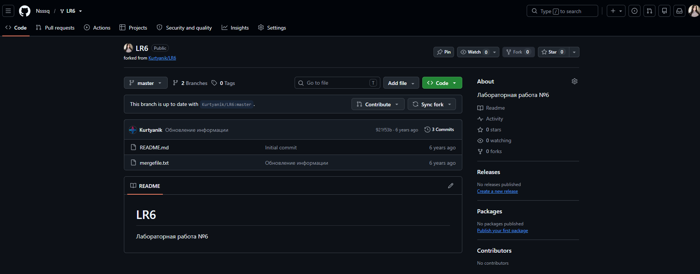

*Рисунок 1. Собственная копия учебного репозитория на GitHub.*

## 2\. Установка и настройка Git

Установлен Git версии `2.56.0.windows.4`. В настройках клиента заданы имя автора в формате «группа, фамилия, инициалы» и адрес электронной почты. Дополнительно отключено экранирование русских имен файлов в выводе Git.

```bash
git --version
git config --global user.name "4516 Петухова Н. П."
git config --global user.email "natalia.petukhova2008@gmail.com"
git config --global core.quotepath false
git config --global --get user.name
git config --global --get user.email
```

Проверка настроек подтвердила, что новые локальные коммиты будут сохраняться с указанными данными автора.

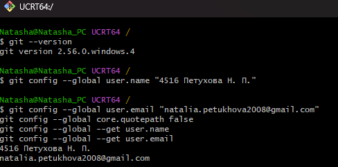

*Рисунок 2. Версия Git и настройка данных автора.*

## 3\. Клонирование удаленного репозитория

В домашнем каталоге создана папка `GitLabs`. В нее по HTTPS клонирован собственный репозиторий `Nsssq/LR6`. После перехода в папку `LR6` выполнены проверка состояния и просмотр адресов удаленного репозитория.

```bash
mkdir -p \\\~/GitLabs
cd \\\~/GitLabs
git clone https://github.com/Nsssq/LR6.git
cd LR6
git status
git remote -v
```

После клонирования активна ветка `master`. Рабочая папка не содержит незафиксированных изменений, а `origin` для получения и отправки данных указывает на собственный репозиторий.

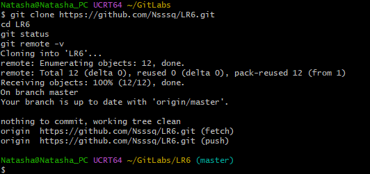

*Рисунок 3. Клонирование репозитория и проверка origin.*

## 4\. Создание файла на GitHub и получение изменений

Через веб-интерфейс GitHub в ветке `master` создан файл `github-note.txt` с текстом «файл создан через интерфейс GitHub». В сетевом репозитории появился коммит `f13ecfe` с комментарием `Create github-note.txt`. Изменения получены в локальную копию командой `pull`.

```bash
git switch master
git pull --ff-only origin master
ls
cat github-note.txt
```

Обновление прошло в режиме fast-forward. Команда `ls` показала новый файл, а `cat` подтвердила его содержимое.

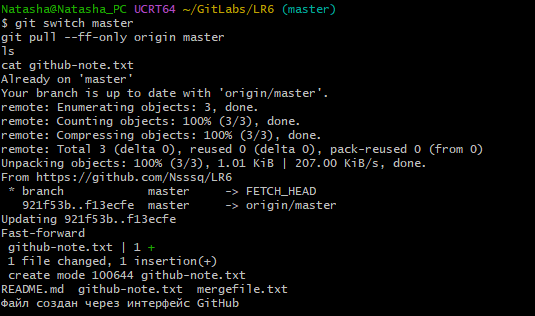

*Рисунок 4. Получение созданного на GitHub файла в локальный репозиторий.*

## 5\. Просмотр веток и истории операций

Для доступа к веткам исходного проекта добавлен удаленный репозиторий `upstream`. После получения его данных выбрана учебная побочная ветка `branch1`. Для удобства ее имя сохранено в переменной `side`. Локальная ветка `branch1` создана с отслеживанием `upstream/branch1`.

```bash
git remote add upstream https://github.com/Kurtyanik/LR6.git
git fetch upstream
git branch -a
side="branch1"
git switch -c "$side" --track "upstream/$side"
git --no-pager log --oneline --decorate "$side"
git --no-pager log --oneline --decorate master
git --no-pager log --graph --oneline --decorate --all
```

В истории `branch1` найден коммит `0f9f50d` с комментарием «Заполнил файл». В истории `master` присутствуют коммит `921f53b` «Обновление информации» и созданный через GitHub коммит `f13ecfe`. Граф истории показывает, что ветки содержат разные изменения после общей части истории.

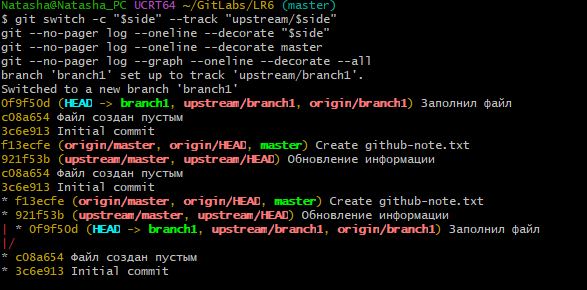

*Рисунок 5. Просмотр истории master и branch1 и общего графа коммитов.*

## 6\. Просмотр последних изменений

Для анализа последних коммитов использована команда `show`, для сравнения содержимого веток - `diff`.

```bash
git --no-pager show --stat master
git --no-pager show master
git --no-pager show "$side"
git --no-pager diff master "$side"
```

В последнем коммите `master` добавлен `github-note.txt`. В `branch1` изменен `mergefile.txt`. Сравнение веток показало различия в строках этого файла, которые необходимо учитывать при слиянии. Отображаемое в сравнении удаление `github-note.txt` относится к сравнению двух состояний веток и само по себе не удаляет файл из рабочей папки.

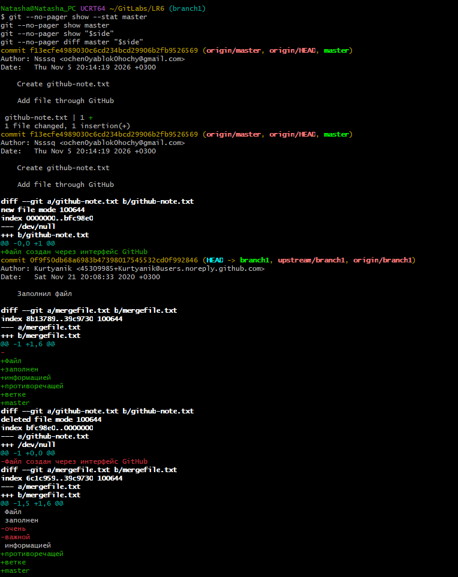

*Рисунок 6. Последние коммиты и различия между ветками.*

## 7\. Слияние branch1 в master и разрешение конфликта

Перед слиянием выполнен переход в `master` и проверена чистота рабочей папки. Затем запущено слияние побочной ветки.

```bash
git switch master
git status
git merge "$side" -m "Merge side branch into master"
```

Git обнаружил конфликт содержимого в `mergefile.txt` и приостановил автоматическое слияние. Причина конфликта состоит в изменении одного участка файла в обеих ветках.

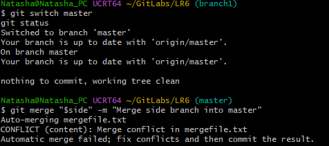

*Рисунок 7. Сообщение Git о конфликте при слиянии.*

В текстовом редакторе просмотрен конфликтный участок. Между маркерами `<<<<<<< HEAD` и `=======` находятся строки из `master`, а между `=======` и `>>>>>>> branch1` - строки из `branch1`. В основной ветке участок содержит слова «очень», «важной», «информацией», а в побочной - «информацией», «противоречащей», «ветке», «master».

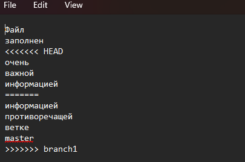

*Рисунок 8. Конфликтный участок mergefile.txt в текстовом редакторе.*

Конфликтный участок отредактирован вручную, служебные маркеры удалены. После проверки изменений исправленный файл добавлен в индекс и создан коммит слияния.

```bash
git --no-pager diff
git diff --check
git add mergefile.txt
git diff --name-only --diff-filter=U
git commit -m "Resolve merge conflict in mergefile.txt"
git status
git --no-pager log --graph --oneline --decorate -10
```

Команда проверки неразрешенных конфликтов после добавления файла не вывела имен файлов. Создан коммит `88d78e6` с комментарием `Resolve merge conflict in mergefile.txt`. Граф истории подтверждает объединение линий изменений. Состояние `working tree clean` показывает, что слияние завершено, незафиксированных изменений нет.

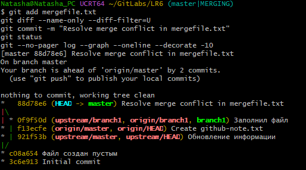

*Рисунок 9. Завершение слияния и коммит разрешения конфликта.*

## 8\. Удаление побочной ветки

После успешного слияния проверена текущая ветка, затем удалена локальная `branch1`.

```bash
git branch --show-current
git branch -d "$side"
git branch
```

Git сообщил `Deleted branch branch1 (was 0f9f50d)`. В списке локальных веток осталась `master`. Изменения побочной ветки сохраняются в объединенной истории основной ветки.

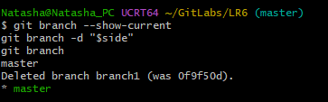

*Рисунок 10. Удаление локальной ветки branch1 после слияния.*

## 9\. Несколько изменений и фиксаций

Для демонстрации последовательных коммитов создан файл `practice.txt`. На каждом этапе в него добавлена одна строка, после чего изменение включено в индекс и зафиксировано с отдельным комментарием.

### 9.1. Первое изменение

```bash
printf '%s\\\\n' '1. Repository and branches studied.' > practice.txt
cat practice.txt
git add practice.txt
git commit -m "Add first practice note"
```

Создан коммит `e7266d1`, добавляющий файл с первой строкой.

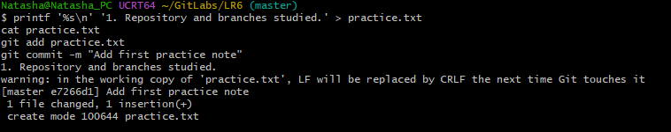

*Рисунок 11. Создание practice.txt и первый учебный коммит.*

### 9.2. Второе изменение

```bash
printf '%s\\\\n' '2. Merge conflict resolved.' >> practice.txt
git --no-pager diff
git add practice.txt
git commit -m "Record conflict resolution in practice note"
```

Команда `diff` показала добавление второй строки. Создан коммит `a4739f1`.

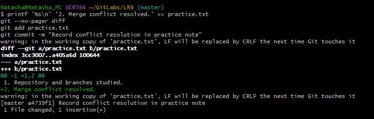

*Рисунок 12. Добавление второй строки и второй учебный коммит.*

### 9.3. Третье изменение

```bash
printf '%s\\\\n' '3. Temporary line for revert demonstration.' >> practice.txt
git add practice.txt
git commit -m "Add temporary line for revert demonstration"
git --no-pager log --oneline -5
```

Создан коммит `8e65cc7` с третьей, временной строкой. В истории отображаются три самостоятельных учебных коммита. Предупреждения о преобразовании LF в CRLF относятся к окончаниям строк; создание коммитов завершилось успешно.

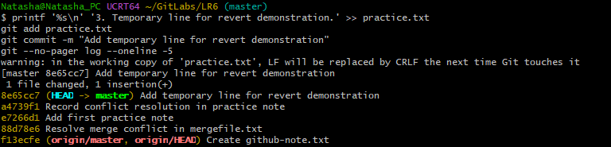

*Рисунок 13. Третий учебный коммит и проверка истории.*

## 10\. Отмена последнего коммита

Перед откатом проверены состояние рабочей папки и последний коммит. Затем командой `revert` отменены изменения коммита `8e65cc7`, на который в этот момент указывал `HEAD`.

```bash
git status
git --no-pager log -1 --oneline
git revert --no-edit HEAD
cat practice.txt
git --no-pager log --oneline -5
git status
```

Создан новый коммит `65fc244` с комментарием `Revert "Add temporary line for revert demonstration"`. Он удалил временную третью строку. Исходный коммит остался в истории, поэтому откат не переписал ранее сохраненные версии. После операции рабочая папка чистая.

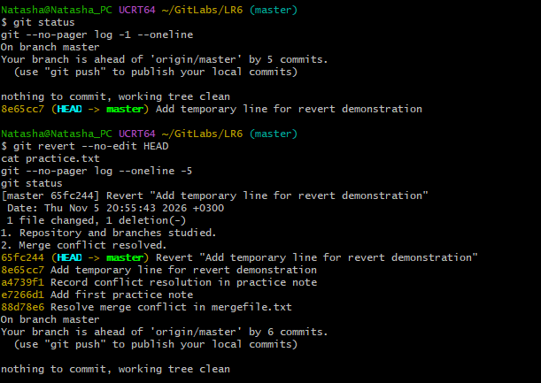

*Рисунок 14. Откат последнего коммита и проверка истории.*

В `practice.txt` после отката осталось следующее содержимое:

```text
1. Repository and branches studied.
2. Merge conflict resolved.
```

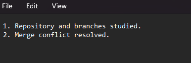

*Рисунок 15. Содержимое practice.txt после отмены временного изменения.*

## 11\. Создание ветки отчета

От текущего состояния `master` создана отдельная ветка `report`.

```bash
git switch master
git switch -c report
git branch
```

В выводе `git branch` перечислены `master` и `report`. Звездочка находится рядом с `report`, что подтверждает переход в ветку отчета. Основные выполненные операции входят в ее историю, так как она создана после отката последнего учебного коммита.

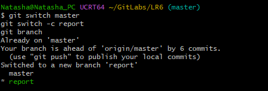

*Рисунок 16. Создание отдельной ветки report.*

## 12\. Оформление отчета

Отчет подготовлен в файле `README.md` с использованием Markdown. Для структуры применены заголовки и подзаголовки, для команд и содержимого файлов - блоки кода. Снимки экрана размещены в отдельной папке `screenshots` и подключены относительными ссылками. Журнал выполненных команд сохранен в `commands.txt` и приведен ниже без результатов выполнения.

## 13\. Журнал выполненных команд

Журнал содержит команды из переданного файла на момент открытия `README.md` для оформления отчета. Символы приглашения терминала `$` исключены; команды, комментарии коммитов и порядок действий сохранены. Команды последующего сохранения и отправки отчета в этот снимок журнала не входят.

```bash
git --version

git config --global user.name "4516 Петухова Н. П."

git config --global user.email "natalia.petukhova2008@gmail.com"
git config --global core.quotepath false
git config --global --get user.name
git config --global --get user.email

mkdir -p \\\~/GitLabs
cd \\\~/GitLabs

git clone https://github.com/Nsssq/LR6.git
cd LR6
git status
git remote -v

git switch master
git pull --ff-only origin master
ls
cat github-note.txt

git remote add upstream https://github.com/Kurtyanik/LR6.git
git fetch upstream
git branch -a

side="branch1"

git switch -c "$side" --track "upstream/$side"
git --no-pager log --oneline --decorate "$side"
git --no-pager log --oneline --decorate master
git --no-pager log --graph --oneline --decorate --all

git --no-pager show --stat master
git --no-pager show master
git --no-pager show "$side"
git --no-pager diff master "$side"

git switch master
git status

git merge "$side" -m "Merge side branch into master"

git status
git diff --name-only --diff-filter=U

git --no-pager diff
git diff --check

git add mergefile.txt
git diff --name-only --diff-filter=U
git commit -m "Resolve merge conflict in mergefile.txt"
git status
git --no-pager log --graph --oneline --decorate -10

git branch --show-current
git branch -d "$side"
git branch

printf '%s\\\\n' '1. Repository and branches studied.' > practice.txt
cat practice.txt
git add practice.txt
git commit -m "Add first practice note"

printf '%s\\\\n' '2. Merge conflict resolved.' >> practice.txt
git --no-pager diff
git add practice.txt
git commit -m "Record conflict resolution in practice note"

printf '%s\\\\n' '3. Temporary line for revert demonstration.' >> practice.txt
git add practice.txt
git commit -m "Add temporary line for revert demonstration"
git --no-pager log --oneline -5

git status
git --no-pager log -1 --oneline

git revert --no-edit HEAD
cat practice.txt
git --no-pager log --oneline -5
git status

git switch master
git switch -c report
git branch

explorer.exe .

notepad.exe README.md
```

## 14\. Основные коммиты выполненной работы

Ниже приведены хэши и комментарии, подтвержденные снимками экрана. Полный форматированный журнал с датами и авторами формируется отдельно командой `git log`.

|Сокращенный хэш|Комментарий|Результат|
|-|-|-|
|`f13ecfe`|Create github-note.txt|Файл добавлен через GitHub и получен локально|
|`88d78e6`|Resolve merge conflict in mergefile.txt|Завершено слияние с разрешением конфликта|
|`e7266d1`|Add first practice note|Создан practice.txt|
|`a4739f1`|Record conflict resolution in practice note|Добавлена вторая строка|
|`8e65cc7`|Add temporary line for revert demonstration|Добавлена временная третья строка|
|`65fc244`|Revert "Add temporary line for revert demonstration"|Третья строка отменена новым коммитом|

## Вывод

В ходе работы создана собственная копия репозитория на GitHub и получена ее локальная версия. Настроены данные автора, изучены история веток и различия файлов. Выполнено слияние `branch1` в `master` с ручным разрешением конфликта, после чего локальная побочная ветка удалена.

Практическая часть показала, что коммит сохраняет изменение в локальной истории, а получение и отправка сетевых изменений выполняются отдельными командами. Для отмены изменения использован `revert`: он создал новый коммит и сохранил исходную историю. Для оформления материалов создана ветка `report`; отчет содержит описание действий, журнал команд и снимки экрана.

## Форматированная история операций

Полная история с датами и именами авторов добавляется после промежуточных коммитов оформления отчета, перед его финальной фиксацией. Ниже будет размещен фактический вывод команды:

git --no-pager log --all --date=short --pretty=format:"%h | %ad | %an | %s"


65fc244 | 2026-11-05 | 4516 Петухова Н. П. | Revert "Add temporary line for revert demonstration"

8e65cc7 | 2026-11-05 | 4516 Петухова Н. П. | Add temporary line for revert demonstration

a4739f1 | 2026-11-05 | 4516 Петухова Н. П. | Record conflict resolution in practice note

e7266d1 | 2026-11-05 | 4516 Петухова Н. П. | Add first practice note

88d78e6 | 2026-11-05 | 4516 Петухова Н. П. | Resolve merge conflict in mergefile.txt

f13ecfe | 2026-11-05 | Nsssq | Create github-note.txt

921f53b | 2020-11-21 | Kurtyanik | Обновление информации

0f9f50d | 2020-11-21 | Kurtyanik | Заполнил файл

c08a654 | 2020-11-21 | Kurtyanik | Файл создан пустым

3c6e913 | 2020-11-21 | Kurtyanik | Initial commit


